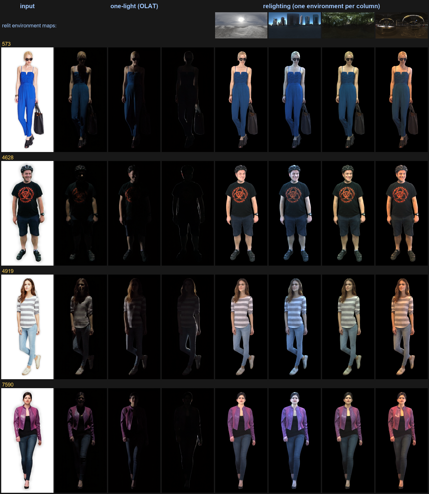
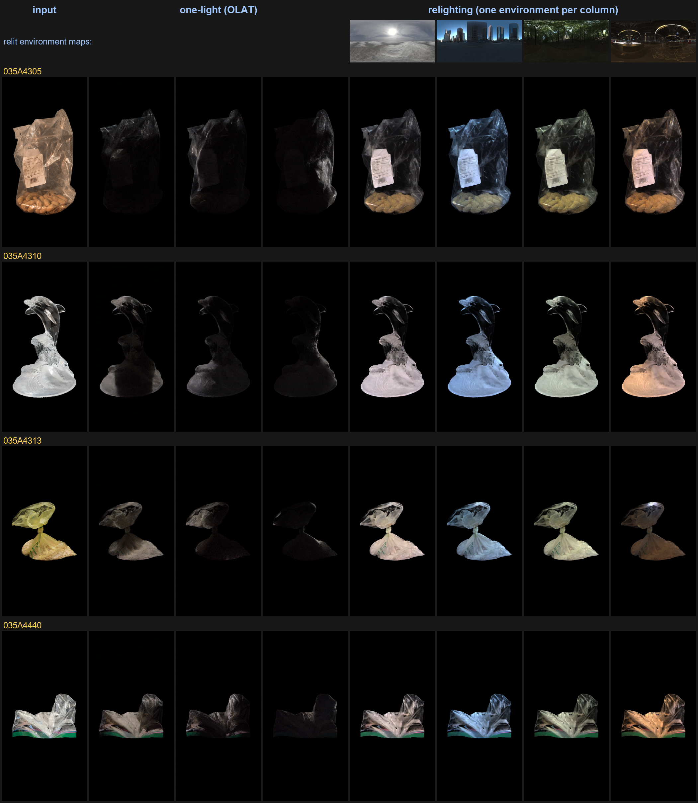

# Anonymous Rebuttal Evidence — Generalization of Relighting

This repository provides qualitative evidence for the rebuttal: our model,
trained on light-stage OLAT captures, **generalizes beyond its training
distribution** — to (1) full-body in-the-wild portraits and (2) general
everyday objects. All results are single-feed inference outputs (the w333
full-window configuration described in the paper), with no per-sample tuning
and no test-time adaptation.

**How to read the grids:** each row is one subject/object with 8 panels —
- col 1: input image;
- cols 2–4: one-light-at-a-time (OLAT) relit frames at lamp positions
  0 / 165 / 248 of the 331-lamp spiral (fixed exposure — near-black panels
  are expected when the active lamp faces away from the subject);
- cols 5–8: relighting under four novel environment maps — one environment
  per column, shared across all subjects/objects; the corresponding
  environment maps are shown as thumbnails above these columns (auto
  exposure).

## 1. Full-body in-the-wild relighting (4 subjects)

Inputs are full-body portraits from SHHQ, preprocessed by our in-the-wild
pipeline (no light-stage capture; the model is never given the test subjects).

Full-resolution per-subject sheets: [`figs/fullbody/`](figs/fullbody/)
(subjects: 573, 4628, 4919, 7590).

## 2. General object relighting (Composition-1k, 10 objects)

Inputs are objects and pets from Composition-1k, relit under novel
illuminations.

Test domain (6 objects):

Train-adobe domain (4 objects):

Full-resolution per-object sheets: [`figs/comp1k/`](figs/comp1k/) (10 objects).

## 3. Comparison with diffusion-based relighting (with ground truth)

A held-out light-stage subject relit under three environment maps by two
diffusion-based relighting methods (RelightLive, DiffusionRenderer) and ours,
with **light-stage ground-truth (GT) composites** for reference. The diffusion
baselines introduce color casts, underexposure, and halo/compositing artifacts
around the hair; ours stays artifact-free with consistent identity and light
response closest to GT.

## 4. Comparison with POLAR on in-the-wild inputs

Three in-the-wild subjects relit under the same environment maps for both
methods. The OLAT directions are not paired one-to-one between the two
methods (footer note in the figure), but the relighting conditions are.
Our full lamp coverage directly represents light from behind the subject
(cf. the rim lighting in case 1).

## 5. Relighting video demo

A portrait relit under a time-varying environment map (top strip; left = input, right = relit).

---
*Anonymous evidence repository — provided for review only; please do not
attempt to identify the authors.*
