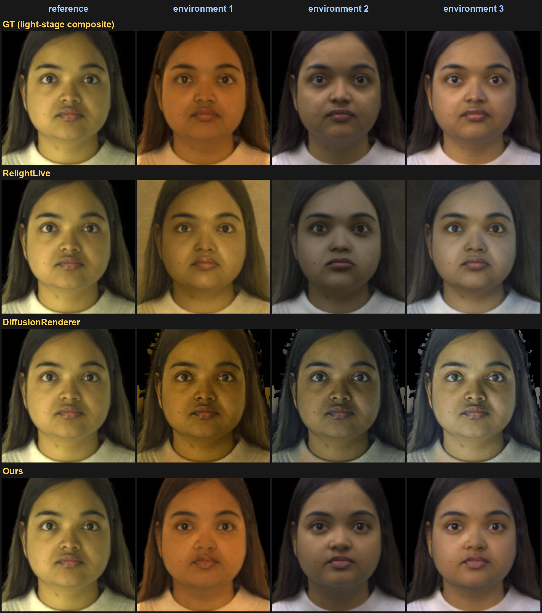
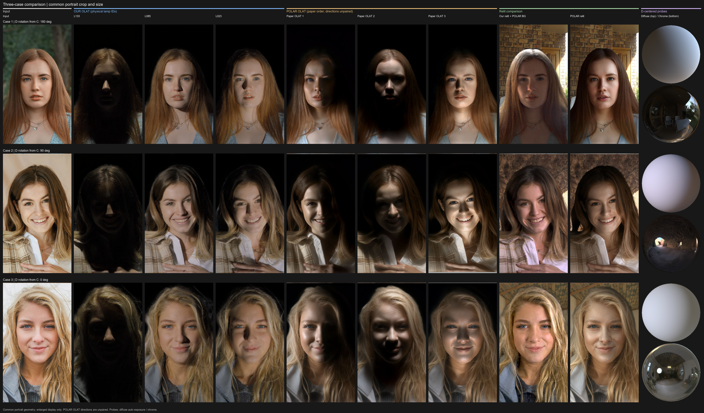
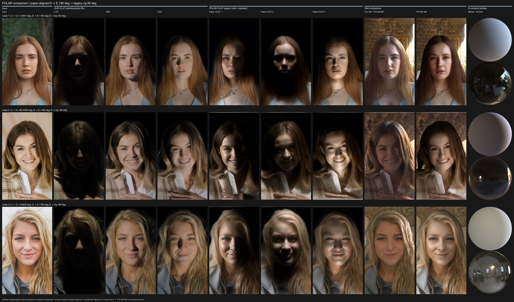
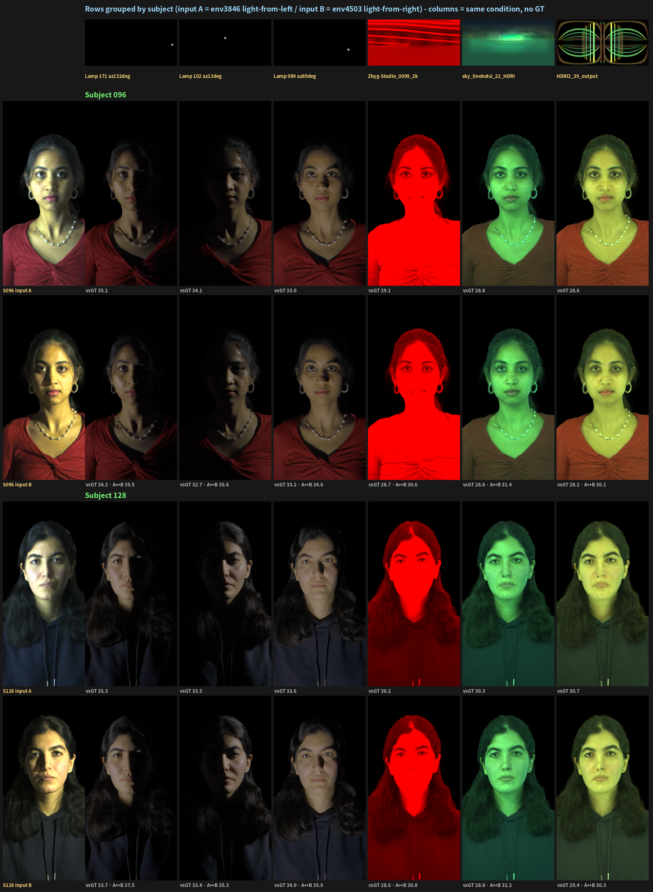
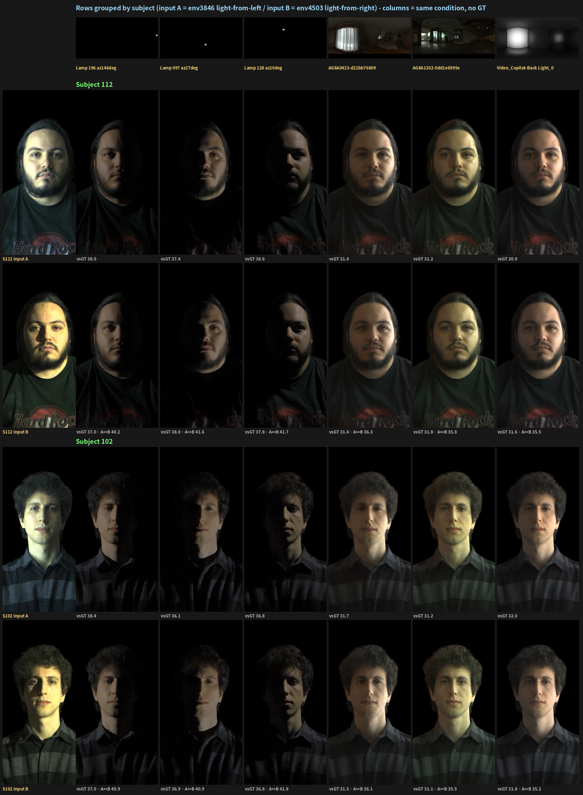
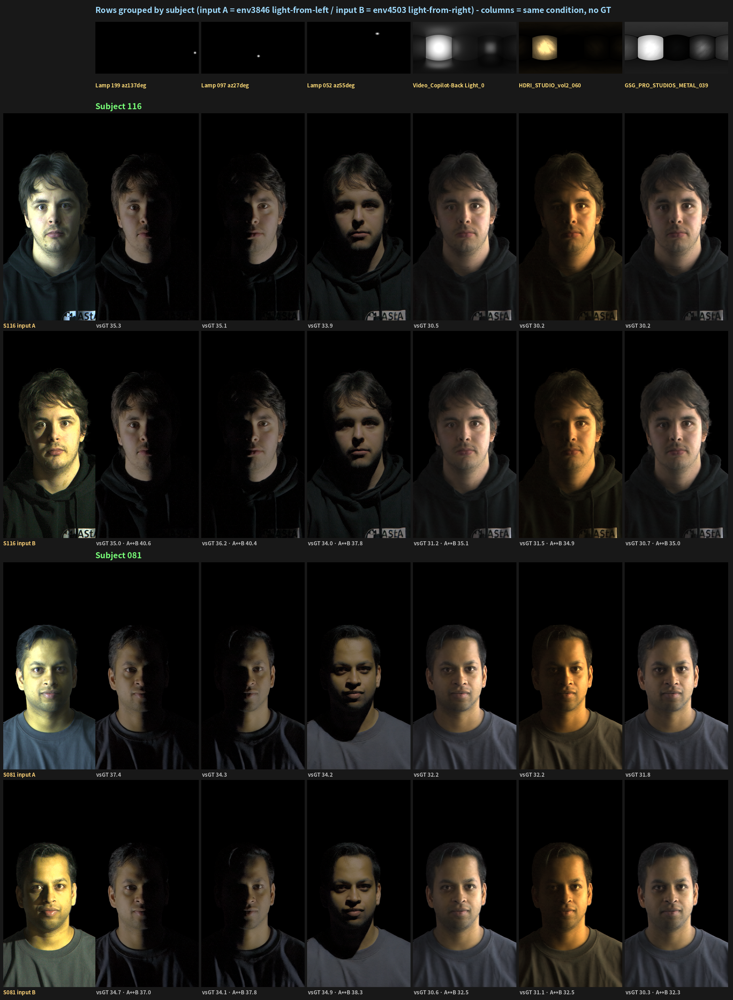
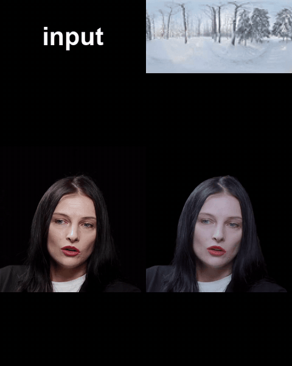

# Anonymous Rebuttal Evidence — Generalization of Relighting

Qualitative evidence: relighting generalization to full-body in-the-wild
portraits and to general objects, plus comparison figures and a video demo.

**How to read the grids:** each row is one subject/object — col 1 input,
cols 2–4 one-light (OLAT) frames, cols 5–8 relit under the four environment
maps shown above the columns.

## 1. Full-body in-the-wild (4 subjects)

Inputs are full-body portraits from SHHQ.

Per-subject sheets: [`figs/fullbody/`](figs/fullbody/) (573, 4628, 4919, 7590).

## 2. General objects (Composition-1k, 10 objects)

Test domain (6):

Train-adobe domain (4):

Per-object sheets: [`figs/comp1k/`](figs/comp1k/) (10 objects).

## 3. Comparison with diffusion-based relighting (with ground truth)

Rows: GT (light-stage composite) / RelightLive / DiffusionRenderer / Ours;
columns: reference + 3 environments.

## 4. Comparison with POLAR on in-the-wild inputs

Three in-the-wild subjects relit under the same environment maps for both
methods. The OLAT directions are not paired one-to-one between the two
methods (footer note in the figure), but the relighting conditions are.
Columns: 1 input; 2–4 our OLAT; 5–7 POLAR OLAT; 8 our relit;
9 POLAR relit; 10 diffuse/chrome probes.

Variant with the environment-map rotation adjusted to align with the paper's
figure (D→E 180° → legacy rig 90°):

## 5. Input-lighting robustness

Examples are picked from the test set. Each grid: the same subject given two differently-lit inputs (input A: light
from the left; input B: light from the right); columns show the same output
condition (same OLAT lamp frame / same relit environment map, no GT).
Outputs from both inputs converge — shadows in the input are not baked into
the output.

## 6. Talking-head relighting demo

Talking-head demo (left = input, right = relit).

---
*Anonymous evidence repository — provided for review only; please do not
attempt to identify the authors.*
