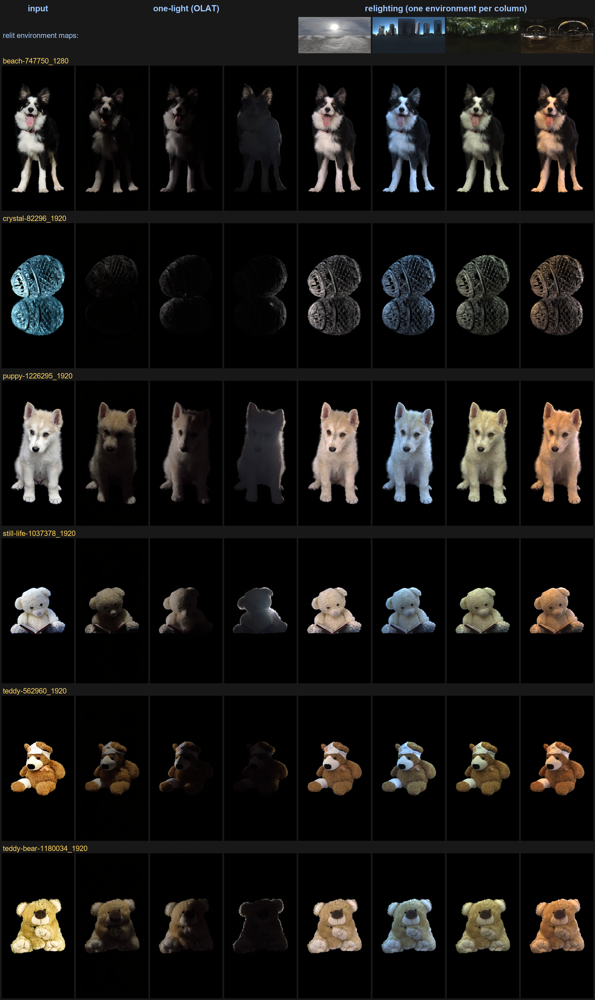

# Anonymous Rebuttal Evidence — Generalization of Relighting

Qualitative evidence: relighting generalization to full-body in-the-wild
portraits and to general objects, plus comparison figures and a video demo.

**How to read the grids:** each row is one subject/object — col 1 input,
cols 2–4 one-light (OLAT) frames, cols 5–8 relit under the four environment
maps shown above the columns.

## 1. Full-body in-the-wild (4 subjects)

Inputs are full-body portraits from SHHQ.

Per-subject sheets: [`figs/fullbody/`](figs/fullbody/) (573, 4628, 4919, 7590).

## 2. General objects (Composition-1k, 10 objects)

Test domain (6):

Train-adobe domain (4):

Per-object sheets: [`figs/comp1k/`](figs/comp1k/) (10 objects).

## 3. Comparison with diffusion-based relighting (with ground truth)

Rows: GT (light-stage composite) / RelightLive / DiffusionRenderer / Ours;
columns: reference + 3 environments.

## 4. Comparison with POLAR on in-the-wild inputs

Three in-the-wild subjects relit under the same environment maps for both
methods. The OLAT directions are not paired one-to-one between the two
methods (footer note in the figure), but the relighting conditions are.
Our full lamp coverage directly represents light from behind the subject
(cf. the rim lighting in case 1).

## 5. Relighting video demo

A portrait relit under a time-varying environment map (top strip; left = input, right = relit).

---
*Anonymous evidence repository — provided for review only; please do not
attempt to identify the authors.*
